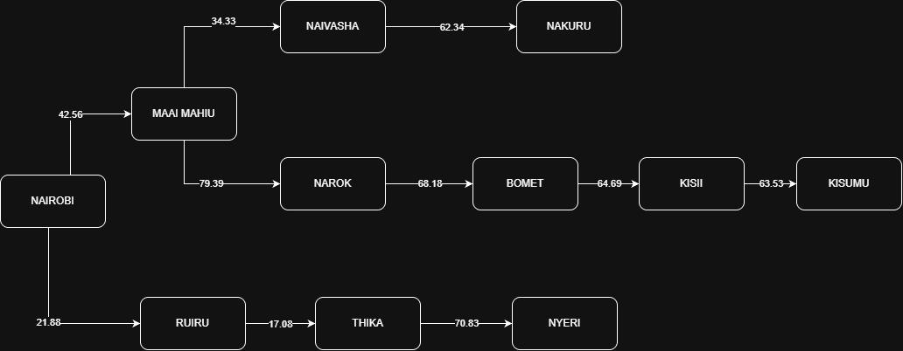

# Self-Driving Trailer Agent: PEAS, Highway Graph, and Route Search

## 1. PEAS Framework and Environment Characteristics

### 1.1 PEAS Specification for the Self-Driving Trailer Agent

- **Performance Measure (P)**
  - **Safety and compliance:** Zero collisions; adherence to Kenyan traffic laws, axle load limits, speed limits, and designated freight corridors.
  - **Efficiency:** Minimize total distance (km), transit time (hours), and diesel fuel consumption.
  - **Cargo integrity:** Preserve cargo condition through smooth braking and acceleration, while avoiding rough bypasses and potholes.
  - **Schedule adherence:** Arrive punctually at distribution depots in Kisumu.
  - **Cost optimization:** Minimize wear and tear and avoid road-damage penalties.

- **Environment (E)**
  - Kenyan primary trunk road corridors (A8/A104 Northern Corridor, B1, and C-class feeder roads).
  - Road-surface variations, including dual carriageways, single-lane climbs such as the Kinungi/Flyover escarpment, unpaved diversions, road works, and speed bumps.
  - Variable weather conditions, including heavy equatorial rains and fog along Limuru/Mau Summit.
  - Mixed vehicular and non-vehicular traffic, including matatus, heavy-haulage trucks, boda-bodas, pedestrians, and wandering livestock.
  - Waypoints, weighing-scale stations (e.g., Gilgil weighbridge), police checkpoints, and freight logistics depots.

- **Actuators (A)**
  - **Drive train:** Throttle controller, electronic retarder, and regenerative/friction braking systems.
  - **Steering system:** Electric power-assisted steering (EPAS) for lane-keeping and turns.
  - **Transmission and pneumatics:** Automatic gear selector, air-brake lines, and trailer-suspension leveling.
  - **Signaling and warnings:** Headlights, hazard indicators, horn, turn blinkers, reversing alarms, and Vehicle-to-Everything (V2X) communication transceivers.

- **Sensors (S)**
  - **Vision and ranging:** Long-/medium-range LiDAR, multi-camera surround-vision arrays, front/rear millimeter-wave radar units, and ultrasonic proximity-parking sensors.
  - **Localization and navigation:** High-precision RTK-GPS receiver, Inertial Measurement Unit (IMU), and wheel-odometry sensors.
  - **Chassis diagnostics:** Axle strain gauges, tire-pressure monitoring systems (TPMS), brake-temperature monitors, and engine telemetry (CAN bus).

### 1.2 Environment Classification (Five Dimensions)

1. **Partially observable:** The trailer cannot observe the full state of the Kenyan road network simultaneously. Sensor range is limited by terrain, curves, weather, and physical obstructions (e.g., blind corners in the Rift Valley escarpment). The agent must infer traffic congestion, stalled vehicles ahead, and immediate road hazards using real-time perception and route updates.

2. **Stochastic:** The outcome of an action cannot be predicted with certainty. Accelerating or changing lanes involves uncertainty due to sudden maneuvers by other drivers (e.g., oncoming overtaking vehicles on single-lane roads), unpredictable pedestrian crossings, livestock, or variable tire traction on wet tarmac.

3. **Sequential:** Current driving and routing decisions directly constrain and influence future choices. Choosing an initial trunk corridor (e.g., via Nakuru or via Narok) commits the agent to specific elevation profiles, fuel-consumption rates, and alternate branch options farther along the journey.

4. **Dynamic:** The external environment changes continuously while the agent is deliberating. Vehicles move, traffic jams develop at roundabouts or urban junctions (such as Westlands, Naivasha, or Nakuru), and weather conditions shift independently of the agent’s decision-making cycle.

5. **Continuous:** The physical state space and action space are continuous. Speed, position coordinates, steering-wheel angles, and braking forces vary along continuous real-valued ranges rather than in discrete grid steps. At the high-level path-planning/graph-abstraction layer, town waypoints are modeled discretely, but the operating driving environment itself is continuous.

## 2. Directed Graph

The directed graph represents a simplified section of Kenya's highway network, covering selected major towns in the Nairobi, Central Highlands, Rift Valley, and Lake Victoria Basin regions. Major towns were selected instead of smaller towns to simplify the representation of the road network and make the search process easier to understand.

Each node represents a major town, while each edge represents a road connection between two towns. The edges are labelled with the distances between the connected towns, measured in kilometres (km), as obtained from Google Maps.

Although the graph uses directed arrows to represent road connections, the roads are assumed to be bidirectional. Therefore, travel between two connected towns is possible in either direction. For clarity, the diagram may show one arrow per connection, with the understanding that the reverse direction is also permitted.

### Directed graph diagram

## 3. Abstract Search Tree

The search tree represents the possible routes explored by the self-driving trailer agent as it searches for a path from Nairobi to Kisumu. Nairobi is the initial state, while Kisumu is the goal state.

The tree is derived from the highway network graph using abstraction. Instead of representing every road, junction, and smaller settlement, the model focuses on major towns and the connections between them. This reduces the complexity of the environment while preserving the information required for route searching.

The branches represent alternative paths that the agent can explore. Each edge is labelled with the distance between the connected towns in kilometres. These distances can be added together to calculate the cumulative path cost from Nairobi to any town in the search tree.

Since the roads are bidirectional, the agent may travel in either direction along a valid road connection.

### Abstract search tree diagram

.jpg.jpeg)

## 4. Path Cost and Route Comparison

Let \(G = (V,E)\) be the road graph, and let \(d(u,v)\) be the distance in kilometres for a road connecting towns \(u\) and \(v\). A valid path \(P = (n_0,n_1,\ldots,n_k)\) is a sequence of towns where each consecutive pair is connected by a road. Its path-cost function is:

\[
g : \operatorname{Paths}(G) \to \mathbb{R}_{\ge 0}, \qquad
g(P) = \sum_{i=0}^{k-1} d(n_i,n_{i+1})
\]

Because the roads are assumed to be bidirectional, \(d(u,v)=d(v,u)\) for each connected pair of towns. The cost of a route is therefore the sum of its road distances.

**Path A — via Oyugis:**

Nairobi → Maai Mahiu → Narok → Bomet → Kisii → Oyugis → Kisumu

\[
g(P_A) = 42.56 + 79.39 + 68.18 + 64.69 + 18.75 + 45.23
= \mathbf{318.80\ km}
\]

**Path B — via Homa Bay:**

Nairobi → Maai Mahiu → Narok → Bomet → Kisii → Homa Bay → Kisumu

\[
g(P_B) = 42.56 + 79.39 + 68.18 + 64.69 + 38.66 + 57.78
= \mathbf{351.26\ km}
\]

### Optimal path based on the provided distances

Path A, via Oyugis, has the lower calculated distance at **318.80 km**, compared with **351.26 km** for Path B. Therefore, Path A is the shortest of these two compared routes based on the supplied edge distances.
